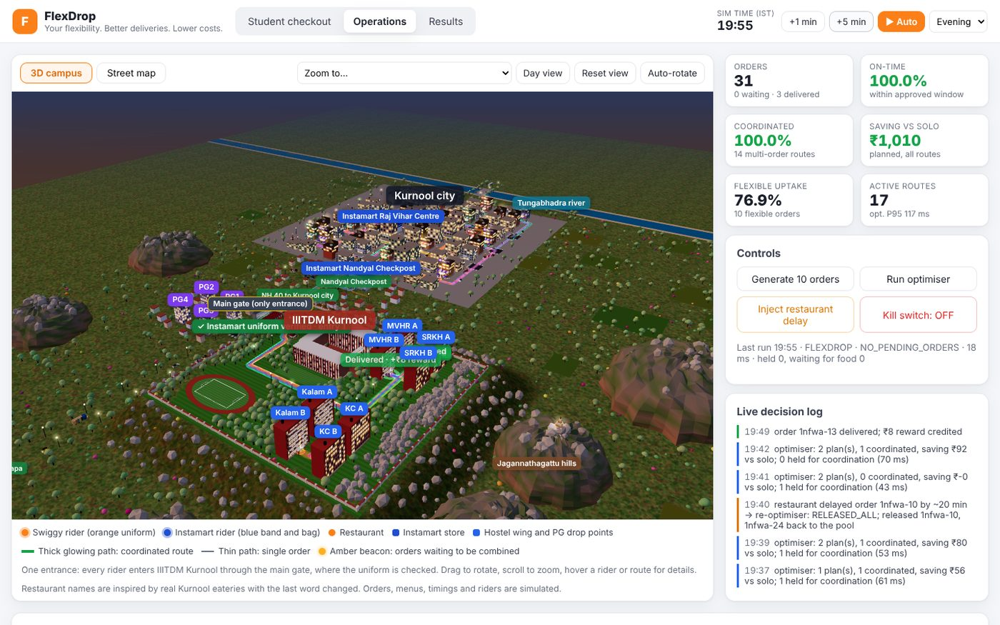
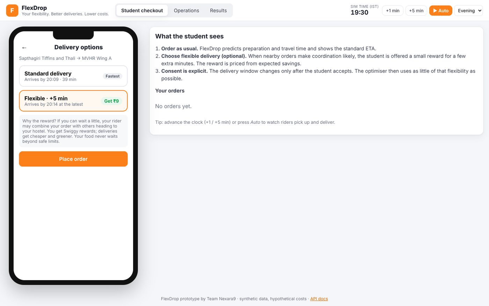
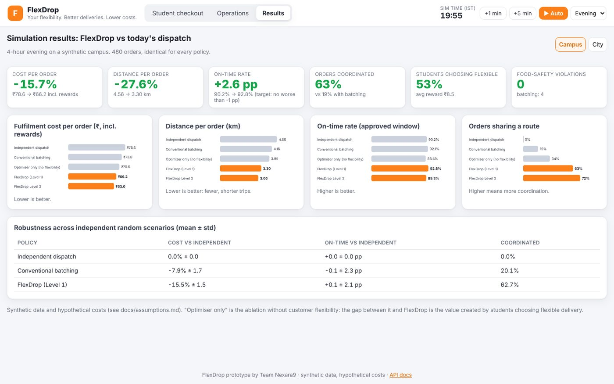
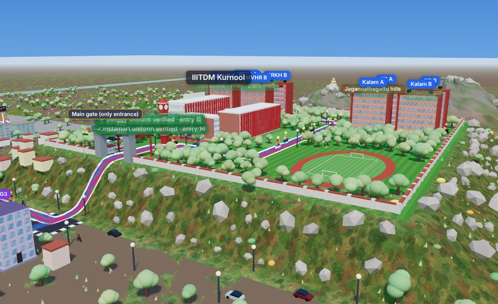
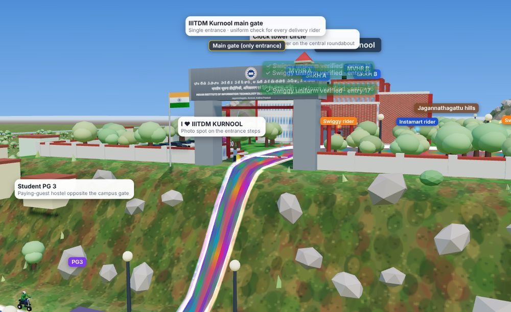
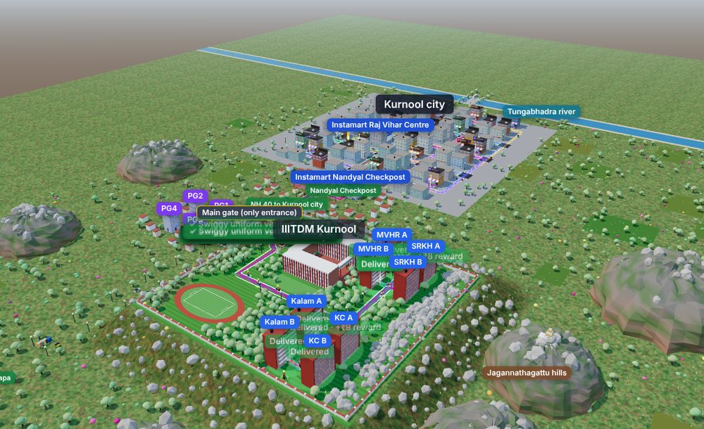
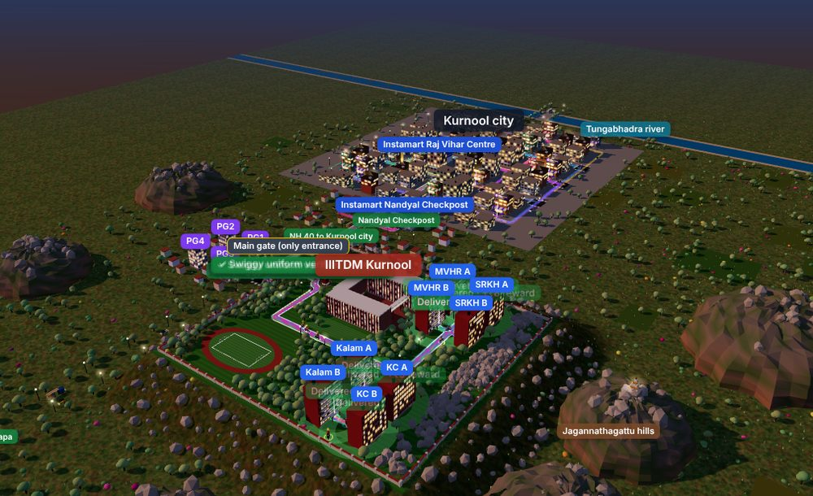
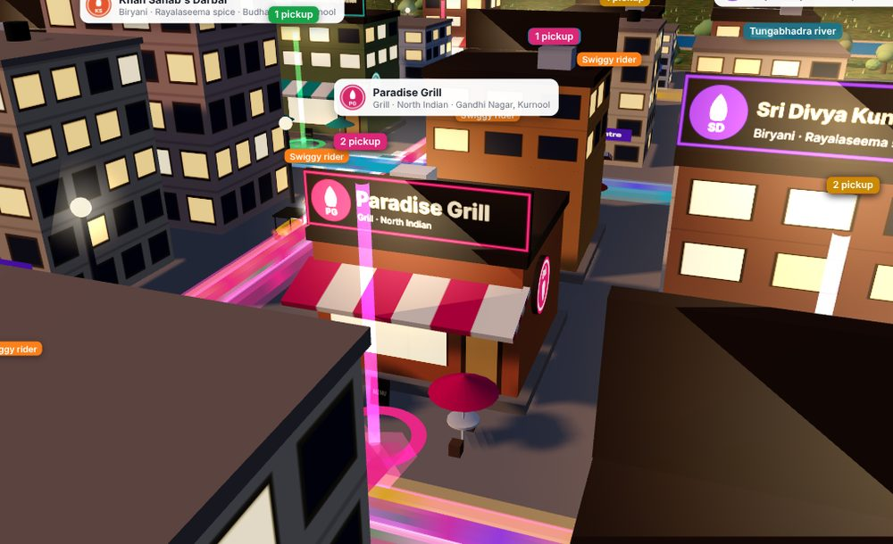

# FlexDrop — Adaptive Delivery Coordination Engine

[](https://github.com/sujal128005/FlexDrop/actions/workflows/ci.yml)

> **Your flexibility. Better deliveries. Lower costs.**
> Team **Nexara9** (Sujal & Navya) · Swiggy *Food for Thought 2.0*

FlexDrop treats **customer-approved delivery flexibility** as an explicit, bounded optimisation
variable. At checkout, a student can choose *"deliver 10 minutes later and get ₹8 back"*. FlexDrop
prices that offer from expected savings. It then uses only as much of each customer's approved
flexibility as needed (the *flexibility budget*) to coordinate compatible Food and Instamart
orders onto fewer, shorter partner routes. Every approved window, food-safety limit and partner
earnings floor is still respected.

This repository contains the **complete working system**:

| Module | What it does | Code |
|---|---|---|
| **CFI** Customer Flexibility Intelligence | Logistic-regression acceptance model (monotone in reward/wait), explicit consent capture | `ml/models.py`, `services/orders.py` |
| **EIO** Economic Incentive Optimizer | Chooses the reward per wait option that maximises `p(accept)·(q·S̄ − r)` under viability caps | `engines/incentive.py` |
| **OCI** Order Compatibility Intelligence | Hard rules for temperature, contamination, leaks, fragility, capacity, category, space and time, plus a ranking score | `engines/compatibility.py` |
| **DCO** Dynamic Coordination Optimizer | Rolling-horizon column generation, exact branch-and-bound route sequencing, and CP-SAT set packing | `engines/optimizer.py`, `engines/routing.py` |
| **Flexibility Budget Allocation** | `0 ≤ s_i ≤ w_i`, minimum-use allocation, hold/dispatch deadlines | `engines/flexibility.py` |
| **CRE** Continuous Re-optimisation | Re-plans after prep delays, cancellations and partner drop-outs; splits routes and never extends a window without approval | `engines/reoptimizer.py` |
| **Prediction layer** | Prep time (mean + P90), travel time, acceptance, coordination probability; trained and registered | `ml/` |
| **API service** | FastAPI with API-key RBAC, rate limiting, idempotency, audit log, kill switch, Prometheus metrics | `api/`, `services/`, `db/` |
| **Simulator** | Discrete-event simulation comparing 5 dispatch policies on synthetic campus and city scenarios | `simulation/` |



## Screenshots

| | |
|---|---|
|  |  |
| **Student checkout**: standard vs flexible delivery, reward priced from expected savings | **Results**: cost, distance, on-time and coordination across 5 dispatch policies |
|  |  |
| **Hilltop campus**: academic area, clock tower, hostel wings, Jagannathagattu hills | **One entrance**: every rider's Swiggy or Instamart uniform is checked at the main gate |
|  |  |
| **Day**: Kurnool city, NH 40, Nandyal Checkpost and the campus | **Night**: lit windows, signs, street lamps and vehicle lights |
|  |  |
| **Riders in uniform**: Swiggy orange, Instamart band and bag | **Restaurants and Instamart stores** with signboards and logos |

## See it: FlexDrop Studio (browser prototype)

```bash
flexdrop studio            # open http://127.0.0.1:8000/app/
```

Three screens backed by the real API:
* a **student checkout** with standard vs flexible delivery and rewards;
* an **operations dashboard** with a live **3D world** modelled on IIITDM Kurnool and Kurnool
  city: the single main gate where riders' Swiggy or Instamart uniforms are checked, the red
  clock tower, the academic area and 8 hostel wings, NH 40 with real-looking traffic, restaurants
  and Instamart stores with signboards, uniformed riders on a road network, glowing routes,
  day/night lighting, KPIs, re-optimisation and kill switch;
* the **simulation results**. In Colab:
`from flexdrop.colab import launch; launch()`. See [docs/frontend.md](docs/frontend.md),
including a 3-minute demo script.

## Headline results (simulation, synthetic data)

Each run covers 4 hours of evening demand. Costs are hypothetical modelling assumptions
(see [docs/assumptions.md](docs/assumptions.md)). Generate the results with `flexdrop pipeline`;
the full tables are in [reports/SUMMARY.md](reports/SUMMARY.md) and
[reports/ROBUSTNESS.md](reports/ROBUSTNESS.md).

| Scenario | Policy | Cost / order | Distance / order | On-time rate (approved window) |
|---|---|---:|---:|---:|
| Campus (470 orders) | Independent dispatch | ₹78.56 | 4.56 km | 90.2% |
| | Conventional batching | ₹73.78 (−6.1%) | 4.16 km | 92.1% |
| | **FlexDrop L1** | **₹66.21 (−15.7%)** | **3.30 km** | **92.8%** |
| City (404 orders) | Independent dispatch | ₹83.14 | 5.00 km | 95.8% |
| | Conventional batching | ₹79.76 (−4.1%) | 4.67 km | 95.3% |
| | **FlexDrop L1** | **₹72.84 (−12.4%)** | **3.92 km** | **95.0%** |

FlexDrop costs include the rewards paid to flexible customers. Over 5 independent scenario seeds,
FlexDrop L1 cuts cost by **15.5% ± 1.5** (campus) and **10.8% ± 1.3** (city), with on-time rate
unchanged within noise (+0.1 ± 2.1 pp and +0.3 ± 2.9 pp). Food-quality violations are 0 for
FlexDrop L1 in both scenarios. Optimisation P95 latency is about 50 ms. The proposal's pilot
acceptance criteria (≥5% cost reduction, ≤1pp on-time decline, zero food-safety violations,
latency < 5 s) are met in these runs. The ablation `flexdrop_noflex` shows how much of the gain
comes from customer flexibility and how much from the optimiser alone.

## Run it

| Where | Commands |
|---|---|
| Linux, macOS, WSL | `bash scripts/run_all.sh`, then `.venv/bin/python -m flexdrop studio` |
| Windows PowerShell | `powershell -ExecutionPolicy Bypass -File scripts\run_all.ps1`, then `.venv\Scripts\python.exe -m flexdrop studio` |
| Google Colab | see [docs/setup.md](docs/setup.md#google-colab) |
| Public demo (Render, free) | **New → Blueprint** on render.com with this repo; see [docs/deployment.md](docs/deployment.md#0-public-demo-in-five-minutes-render-free) |

Then open http://127.0.0.1:8000/app/. If Windows Smart App Control blocks the compiled Python
libraries ("An Application Control policy has blocked this file"), use WSL or Colab.

## Quick start (no Docker)

Requires Python ≥ 3.11.

```bash
python3 -m venv .venv && source .venv/bin/activate
pip install -c constraints.txt -e ".[dev]"   # exact verified versions

pytest -q                       # 100+ unit, optimisation, simulation & API tests
flexdrop demo                   # scripted end-to-end run through the real HTTP API
flexdrop pipeline               # data -> training -> calibration -> 5-policy comparison (~2 min)
flexdrop serve --port 8000      # API at http://127.0.0.1:8000/docs
```

Or run everything with `bash scripts/run_all.sh` (Linux, macOS, WSL, Git Bash) or, in Windows
PowerShell, `powershell -ExecutionPolicy Bypass -File scripts\run_all.ps1` (see
[docs/setup.md](docs/setup.md#windows-notes)). To make authenticated calls:

```bash
flexdrop create-api-key --name local-admin --roles admin
export FLEXDROP_API_KEYS='<the JSON line printed above>'
flexdrop serve
curl -H "X-API-Key: <key>" http://127.0.0.1:8000/v1/metrics
```

Smoke-test a running server end to end with `bash scripts/smoke_test.sh`.

## CLI

| Command | Purpose |
|---|---|
| `flexdrop generate-data` | Synthetic scenario CSVs and historical training data |
| `flexdrop train` | Train prep/travel/acceptance (and coordination, if samples exist) models |
| `flexdrop simulate` | Compare policies on one scenario |
| `flexdrop pipeline` | Full experiment: generate, train, calibrate, retrain, simulate both scenarios |
| `flexdrop robustness` | Repeat the comparison over several scenario seeds (mean ± std) |
| `flexdrop studio` | Browser prototype (checkout, operations map, results) with a seeded campus |
| `flexdrop demo` | End-to-end API demonstration in the terminal (stores, partners, orders, offers, optimisation, events, metrics) |
| `flexdrop serve` | Run the API (uvicorn) |
| `flexdrop init-db` | Create the schema (development; production uses `alembic upgrade head`) |
| `flexdrop create-api-key` | Generate a key and its SHA-256 configuration entry |
| `flexdrop kill-switch on/off` | Instantly disable or enable FlexDrop; standard dispatch is unaffected |
| `flexdrop purge` | Data-retention purge |

## Repository layout

```
src/flexdrop/
  config.py            engine parameters (EngineConfig) + runtime settings (env)
  domain/models.py     entities: Order, Partner, RoutePlan, ...
  engines/             cost, travel oracle, compatibility, routing, flexibility,
                       incentive, optimizer (DCO), reoptimizer (CRE), promise
  ml/                  features, models (learned + analytic priors), registry, training
  simulation/          scenario generator, history, simulator, policies, metrics, runner
  db/                  SQLAlchemy models + session
  services/            orders/consent, dispatch, catalog, metrics, idempotency, privacy
  api/                 FastAPI app, routers, security, middleware, error handling
  web/                 FlexDrop Studio UI (HTML/CSS/JS modules, bundled three.js and Leaflet)
  studio.py, colab.py  seeded demo world + Colab launcher
  cli.py, demo.py
tests/                 unit/, optimization/, integration/
docs/                  architecture, algorithms, math model, API, database, setup,
                       deployment, simulation, security, assumptions; images/ screenshots
migrations/            Alembic migrations
data/sample/           generated sample data (scenarios + training history)
models/                trained model artefacts + metadata (metrics)
reports/               simulation outputs (SUMMARY.md, ROBUSTNESS.md, per-order CSVs)
deploy/                systemd unit, nginx config, production env template
render.yaml            one-click public demo on Render (free, no Docker)
```

## Documentation

* [FlexDrop Studio: browser prototype and demo script](docs/frontend.md)
* [Architecture](docs/architecture.md)
* [Algorithms](docs/algorithms.md) and [mathematical model](docs/math_model.md)
* [API specification](docs/api.md) and [database design](docs/database.md)
* [Setup & execution](docs/setup.md) and [deployment (no Docker)](docs/deployment.md)
* [Simulation & results](docs/simulation.md), [security](docs/security.md), [assumptions & decisions](docs/assumptions.md)

## Honest scope statement

FlexDrop is a working decision service and simulator built on **synthetic** data. The figures
above are simulation outputs under documented assumptions; they are not measurements of
Swiggy's operations. The service is designed to run alongside Swiggy's dispatch: in shadow mode
first, then in a small opt-in pilot, with a kill switch and automatic fallback to standard
dispatch ([docs/deployment.md](docs/deployment.md)).
