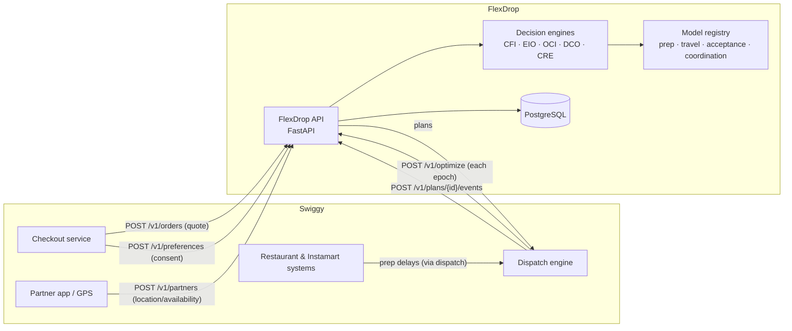
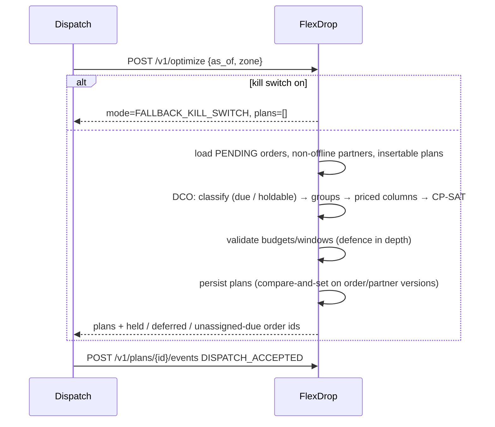

# Architecture

FlexDrop is an **independent decision-support and optimisation service**. It sits next to
Swiggy's existing checkout and dispatch systems and does not replace them. If it is disabled,
times out or fails, dispatch continues on the standard path.

## 1. Context



## 2. Layers

| Layer (proposal §5) | Implementation |
|---|---|
| A. Data ingestion | REST endpoints with strict pydantic validation (`schemas.py`): stores, partners, orders, preferences, plan events |
| B. Prediction | `ml/`: HistGradientBoosting prep-time model (mean + P90 quantile), travel time; logistic acceptance and coordination models; analytic priors on cold start |
| C. Compatibility | `engines/compatibility.py`: hard feasibility rules, then a score |
| D. Optimisation | `engines/optimizer.py` (column generation + CP-SAT set packing), `engines/routing.py` (exact sequencing), `engines/flexibility.py` (budgets), `engines/incentive.py` (offers) |
| E. Execution | Plans are persisted, versioned and returned to dispatch. Dispatch validates and executes them (`DISPATCH_ACCEPTED`/`REJECTED`) |
| F. Monitoring & feedback | Audit log, optimisation-run log, `/v1/metrics`, Prometheus, simulation-driven retraining (`flexdrop pipeline`) |

## 3. Request flows

### 3.1 Checkout: quote and consent

```mermaid
sequenceDiagram
    participant C as Checkout
    participant F as FlexDrop
    C->>F: POST /v1/orders (store, drop, items, handling, customer signals)
    F->>F: predict prep (mean, P90), travel; standard promise
    F->>F: density of open orders; EIO quote per wait option
    F-->>C: standard ETA + offers [{5 min, ₹6}, {10 min, ₹9}, ...]
    C->>F: POST /v1/preferences (ACCEPT_FLEX + offer_id | STANDARD)
    F->>F: validate offer (order, expiry, kill switch); record consent; audit
    F-->>C: approved window = standard ETA + m
```

An order's delivery window changes **only** through an explicit, recorded consent. ML outputs
are quotes and never decisions.

### 3.2 Dispatch: optimisation epoch



If the optimiser raises an error, the run is logged as `FALLBACK_ERROR` and an empty plan set is
returned. Dispatch then handles those orders with its standard logic, so the system never fails
open.

### 3.3 Execution: continuous re-optimisation

`PREP_DELAY`, `ORDER_CANCELLED` and `PARTNER_UNAVAILABLE` events run the CRE, which may:

* keep the plan (`UNCHANGED`, a stability rule),
* resequence it (`RESEQUENCED`, which creates a new plan version),
* split it (`SPLIT`, which releases un-picked orders back to `PENDING` for the next epoch), or
* report on-board orders as `AT_RISK`.

`PICKED_UP` and `DELIVERED` events advance state. On completion the partner returns to `IDLE` and
flexible-delivery rewards are credited.

## 4. Component structure

```
api/        transport: auth, rate limit, idempotency, errors, middleware, routers
services/   transactional use-cases (one DB transaction each), audit trail
engines/    pure decision logic (no I/O) - shared with the simulator
ml/         prediction models, training, registry
db/         ORM models, session management (SQLite dev / PostgreSQL prod)
simulation/ synthetic world + discrete-event simulator + experiment runner
```

The engines are **pure and deterministic** given their inputs, so the same code runs in the API
and in the simulator. That is why the simulation results are evidence about the shipped
algorithms and not about a re-implementation.

## 5. Concurrency and consistency

* Every optimisation run executes inside one DB transaction, with an in-process lock per worker.
* Orders and partners carry an optimistic-lock `version` column. Persisting a plan is a
  compare-and-set (`PENDING→PLANNED`, `IDLE→ASSIGNED`). A concurrent modification raises
  `StaleDataError`, which becomes HTTP 409 and rolls back the whole run.
* Plans are versioned: every re-plan writes a new set of `plan_stops` with `version+1`, and old
  versions are kept for audit.
* POST endpoints accept an `Idempotency-Key`. Replays return the stored response; a reused key with
  a different body returns 409.

## 6. Scalability

* **Zone sharding.** `/v1/optimize` takes a `zone`. Zones (for example a campus or a delivery
  cluster) are independent problems that can run in parallel workers or processes.
* **Bounded problem size.** Candidate generation is limited to top-k neighbours, a maximum group
  size and the `max_candidate_groups` budget. Route sequencing is exact but limited to 4 orders.
  The CP-SAT time limit caps latency, and the greedy solution is always available as a hint and a
  fallback.
* **Per-epoch travel oracle.** One vectorised ML prediction per epoch, with results memoised.
* **Stateless workers.** All state lives in PostgreSQL, so horizontal scaling sits behind nginx.
  Two pieces are in-process today: the rate limiter and the per-process lock. For multi-instance
  deployments, move the rate limiter to a shared store and use one optimisation worker per zone
  ([deployment.md](deployment.md)).

## 7. Deviations from the proposed stack

The proposal listed Kafka, Redis, PostGIS, SimPy and XGBoost. They were not needed to deliver a
correct, testable system. The decisions and upgrade paths are in [assumptions.md](assumptions.md#technology-decisions).
