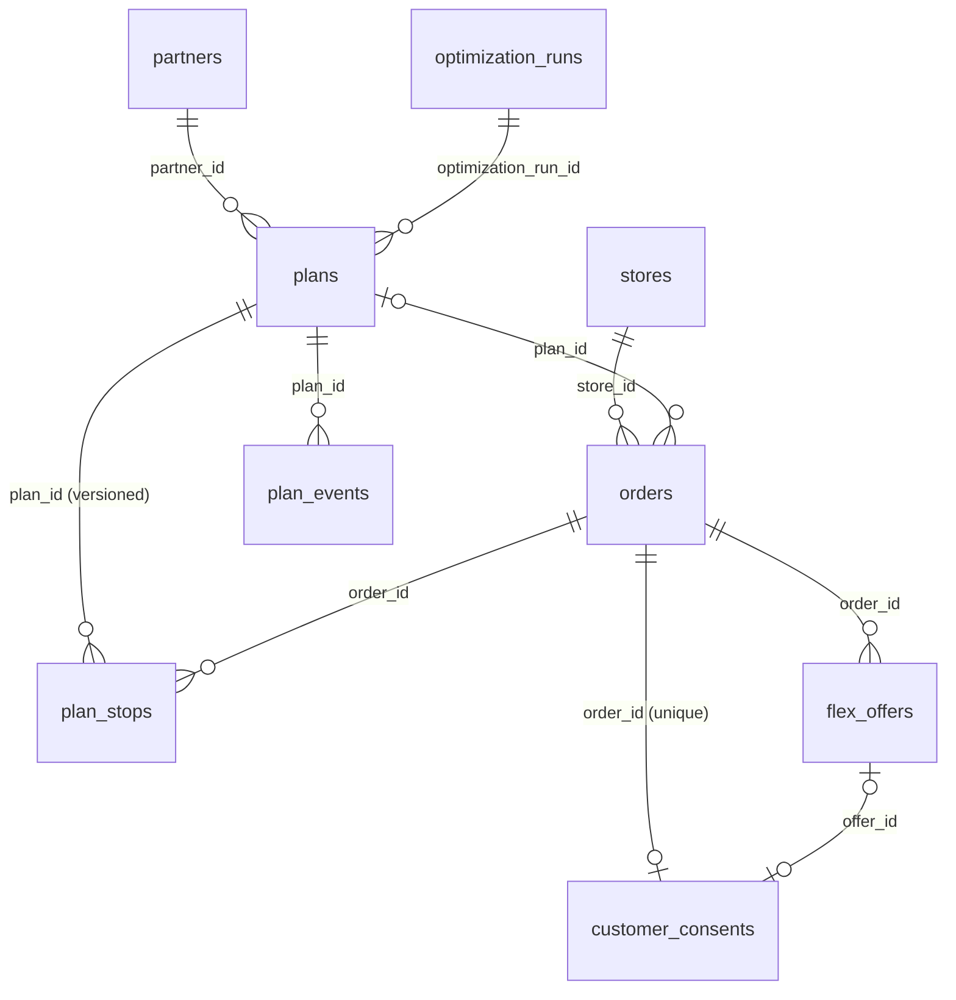

# Database design

SQLAlchemy 2.0 ORM (`src/flexdrop/db/models.py`), with migrations managed by Alembic
(`migrations/`). SQLite is the zero-setup development default; PostgreSQL ≥ 13 is the production
target (install the extra with `pip install -e ".[postgres]"` and set
`FLEXDROP_DATABASE_URL=postgresql+psycopg://...`).

All timestamps are stored as UTC (`UTCDateTime` type decorator; naive datetimes are rejected).

## ER diagram



## Tables

| Table | Purpose | Key columns and constraints |
|---|---|---|
| `stores` | Restaurants and Instamart stores | `category ∈ {FOOD, GROCERY}`, location, `base_prep_min`, `zone` |
| `partners` | Delivery partners | `status ∈ {IDLE, ASSIGNED, OFFLINE}`, location, `available_at`, vehicle (volume, weight, compartments, insulated), optimistic-lock `version` |
| `orders` | Orders with predictions and commitments | `customer_ref` (HMAC pseudonym), pickup/drop, `placed_at`, `predicted_ready_at`, `ready_p90_at`, `promised_at`, `handling` (JSON), `mode`, `max_extra_wait ≥ 0`, `reward ≥ 0`, `reward_status ∈ {NONE, PENDING, CREDITED, FORFEITED}`, `status`, `plan_id`, `store_load`, optimistic-lock `version`; index on `(status, zone)` |
| `flex_offers` | Every quoted offer (auditability of pricing) | `extra_minutes`, `reward`, acceptance and coordination probabilities, expected savings and net value, `expires_at`, `model_versions` |
| `customer_consents` | The explicit customer decision | **unique per order**; `accepted`, `offer_id`, approved minutes and reward, `source`, `recorded_at` |
| `plans` | Delivery plans (current version) | `version`, `status ∈ {PROPOSED, ACCEPTED, IN_PROGRESS, COMPLETED, REJECTED, CANCELLED}`, `kind ∈ {NEW, INSERT, FALLBACK}`, `order_ids`, cost and breakdown, `baseline_cost`, `expected_savings`, `flex_allocation` (s_i per order), `lateness`, `risk_violations`, `started`, `changes` |
| `plan_stops` | Stop sequences, **all versions kept** | unique `(plan_id, version, seq)`; `stop_type`, location, `eta`, `etd`, `wait_min` |
| `plan_events` | Execution events received | `event_type`, `payload`, `result_action`, `plan_version` |
| `optimization_runs` | One row per `/v1/optimize` call | `mode`, `status`, `solver`, latency, problem sizes, `objective`, `error` |
| `audit_logs` | Append-only audit trail | `actor`, `action`, `entity`, `details`, `request_id` |
| `idempotency_records` | Stored responses for POST replays | PK `(actor, key)`, `request_hash`, `status_code`, `response_body` |
| `system_flags` | Runtime flags (kill switch) | `key`, `value`, `updated_by` |

## Invariants enforced in the database

* Check constraints on every status and enum column, and non-negative flexibility and rewards.
* One consent per order (unique constraint).
* One stop per `(plan, version, seq)`.
* Optimistic locking on `orders` and `partners`. Two concurrent optimisation runs cannot both
  plan the same order or assign the same partner.
* Foreign keys are enabled on SQLite (`PRAGMA foreign_keys=ON`) as well as PostgreSQL.

## Audit trail

Each of the following writes an `audit_logs` row with the API principal and request ID:
* order creation, including the model versions and the offers quoted;
* consent decisions;
* plan creation and insertion, including the flexibility allocation, expected savings, objective
  value and risk;
* every plan event and its CRE outcome;
* kill-switch changes;
* store and partner upserts.

## Migrations

```bash
export FLEXDROP_DATABASE_URL=postgresql+psycopg://flexdrop:***@db/flexdrop
alembic upgrade head            # apply
alembic check                   # verify models and migrations agree (also run in the test suite)
alembic upgrade head --sql      # offline SQL for DBA review
alembic downgrade -1            # roll back one revision
```

## Retention and privacy

`flexdrop purge --days N` (default `FLEXDROP_DATA_RETENTION_DAYS=90`) deletes:
* terminal plans older than N days, with their stops and events;
* terminal orders older than N days that no plan references any more, with their offers and
  consents;
* optimisation runs and audit logs older than N days;
* idempotency records older than 2 days.

Active orders are never purged. Raw customer IDs are never stored. Drop coordinates are needed
for routing and are removed by the retention purge.
